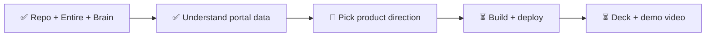

# ask-soony progress
_Last updated: 2026-11-21_

One line per person under **Now**. Update it when you start or finish something, then commit and push right away. See "Team workflow" in AGENTS.md.

## Now
- Akshat: picking product direction (proposal: launch-weekend war-room agent)
- Jonas: data watcher agent: polls the portal, keeps every file version, LLM analysis of each change, notifiers (`src/ask_soony/`)

## Next
- Pick the product direction (one problem, go deep)
- Deploy target and stack

## Done
- 2026-11-21: Read all 308 portal files; findings in local `data/UNDERSTANDING.md` (gitignored, ask Akshat): 4 hidden shortfalls, 22 contradictions
- 2026-11-21: Entire session tracking and Brain shared memory set up (see AGENTS.md)
- 2026-11-21: `.env.example` for the portal token

## Blockers
- None

## Decisions
- Coordinate through this file, not a board: zero setup, and agents follow it via AGENTS.md
