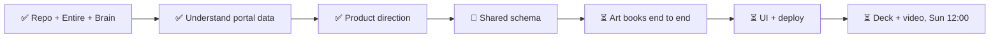

# ask-soony progress
_Last updated: 2026-11-21 22:45_

One line per person under **Now**, with the time. Update it when your status changes and at least every 2 hours, even with no code to push, then commit and push right away. Full plan and ownership: [`plan.md`](plan.md). Workflow: "Team workflow" in AGENTS.md.

## Now
- Akshat (22:45): plan.md written; next: platform UI/UX and wiring all modules together
- Farhan: verification: claim extraction from documents + three-way match (PO ↔ confirmation ↔ receipt) — see plan.md §5
- Lucas: arrival forecast: rules for ETA + road leg, silence detection, news/notice risks, alternatives — see plan.md §5
- Jonas (00:37): alert agent on branch `jonas/alert-agent` (on top of Akshat's dashboard): voice conversation per card (gpt-realtime), PWA push alerts, send drafted supplier mail after a spoken yes, supplier replies tied back to the card (Hwaseong: remaining 20,000 game cards arrive Tue 24 Nov, too late), phone calls via Twilio; next: auto-escalation critical card → push → call, then merge with Akshat

## Next
- Sat 21:00 target (overdue): shared shapes in `src/ask_soony/schema.py`, sender addresses registered, office hours booked
- Sat 23:00: art books path in the CLI (finding → impact → decision → draft email)
- Sun 07:00: UI on real findings; Sun 10:00 freeze + deploy; Sun 11:00 video + deck; **Sun 12:00 submit**

## Done
- 2026-11-21: Product direction fixed and work split (plan.md)
- 2026-11-21: Read all portal files; findings in local `data/UNDERSTANDING.md` (gitignored, ask Akshat)
- 2026-11-21: Entire session tracking and Brain shared memory set up (see AGENTS.md)
- 2026-11-21: `.env.example` for the portal token

## Blockers
- Art books: Nowak rush order must go out tonight to reach the Collector's cell before it runs out (~12:30 Sun) — needs a human decision, plan.md §3
- Cases: 6,000 in stock vs 38,000 needed for Sunday; 350,000 waiting at CTA Hamburg

## Decisions
- Coordinate through this file, not a board: zero setup, and agents follow it via AGENTS.md
- Buyer side only: suppliers refuse new tools and accept email only; supplier side is future scope
- Code calculates, agents read and talk: matching, maths and trust rules are code; reading, judging and writing are agents
- Arrival forecast is rules, not a trained model: ~25 shipments and 30 h left, and rules are explainable on stage
- Demo path is art books end to end first: clearest catch, real deadline tonight
