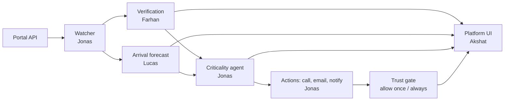

# Plan

_Last updated: 2026-11-21. Owner of this file: Akshat. Read with [`docs/challenge.md`](docs/challenge.md) and [`strategy.md`](strategy.md)._

## 1. The idea in one line

> Soony's numbers are claims. We check them against every document, from order confirmation to delivery note, and act before the line stops.

Soony's SAP and spreadsheets say the launch is fine. The documents that arrived (scans, PDFs in Korean, Chinese and Polish, inspection reports, supplier notices) say it is not. Nobody reads them in time. We do, we put a price on every gap in launch copies, and we get it to the person who can fix it: by call if it is urgent, otherwise by email or a notification.

## 2. Boundaries

- **We work for the buyer (Soony).** We don't do procurement; we watch it and catch problems before they hit the launch.
- **Buyer side only.** We read the data Soony already holds and decide on Soony's side. Suppliers are reached only by email from a registered sender address. No supplier or carrier system access (suppliers told us they refuse new tools). The supplier side is future scope.
- **Not a second SAP.** A layer on top of Soony's systems that reads their exports and inboxes.
- **Nothing hardcoded.** No supplier name, part number or quantity in code. Everything comes from the portal data at runtime. New and changed files must work without a code change, including format changes (e.g. `open_shipments.csv` → `.json`).
- **Contradictions are shown, never silently resolved.** Every finding shows both sides and the source page.
- **Code calculates, agents read and talk.** Matching, maths and trust rules are plain code. Reading messy documents, judging impact, finding the approver and writing to people are agents.

## 3. Problems the system must find (verified against the raw data, 2026-11-21)

| # | Problem | Evidence | Launch impact | Catch point |
|---|---|---|---|---|
| 1 | **Art books** | PO 8,000; goods receipt booked 80,000 "over delivery accepted"; delivery note scan shows 80,000 crossed out, 8,000 handwritten | ~5,900 Collector's copies short | After dock, before packing |
| 2 | **Statues** | Inspection report: 9 of 125 defective, reject at 4; lot of 5,600 booked as unrestricted | 3,400 Collector's short unless a concession is signed (Category Lead post vacant) | After dock, before packing |
| 3 | **Game cards** | PO 48,000; Korean shipping advice: 28,000 flown, 20,000 arrive 24 Nov. Shipment feed still "booked" | ~6,800 short | Before arrival |
| 4 | **Sleeves** | Nowak confirms rev C (from Soony Marketing); PackRight confirms rev B; component master says rev B | 0 or 64,000 short depending on which revision is valid | At confirmation |
| 5 | **Boise terms** | PO says DDP Hamburg, contract says EXW; confirmation: "shipment packed and on hold at our dock" | Cards stuck at supplier | At confirmation |
| 6 | **Silent carrier** | SHP-2026-04281 "in delivery", ETA 20 Nov, no update since 19 Nov 12:00; 7 shipments stale since 19 Nov | Unknown location | Ongoing |
| 7 | **Magnet export ban** (false alarm) | News + PackRight notice: affects deliveries after 1 Dec only; boxes in stock cover the need | None: must say "no launch risk" | Live drop |

| 8 | **Cases** | Stock update Sat 20:50: 6,000 cases vs 38,000 needed; 350,000 discharged at CTA Hamburg since Fri, feed not updated since | Standard lines stop ~1 h into Sunday unless picked up | Ongoing |
| 9 | **Mislabelled pallet** | GR 5000413071 + scan WZ-261120-732: "1 Pal. = GH5 Sleeves!" (4,000 pcs), booked as GH6 sleeves | 4,000 wrong sleeves in GH6 stock | After dock, before packing |

### Status after the Saturday shift (stock update 2026-11-21 20:50, verified)

Left for Sunday 06:00–20:00 (14 h): **38,000 Standard** (~6.3 h on 3 lines) and **11,700 Collector's** (13 h in the cell, **1 h slack**).

| Part | Book stock | Usable | Need | Balance |
|---|---|---|---|---|
| Game card | 42,900 | 42,900 | 49,700 | **−6,800** (Collector's first → Standard short) |
| Case | 6,000 | 6,000 | 38,000 | **−32,000 unless CTA pickup Sunday morning** |
| Art book | 77,800 | 5,800 (72,000 phantom) | 11,700 | **−5,900**; cell runs out ~12:30 Sun. Nowak rush (4 h load + ~9 h truck) must be ordered **tonight** to arrive in time |
| Statue | 13,900 | 8,300 (5,600 failed lot) | 11,700 | **−3,400** without concession |
| Sleeve | 116,000 | ≥48,000 even without rev B and the GH5 pallet | 38,000 | ok, pull the wrong pallet |
| Steel case / box / poster | 17,900 / 14,000 / 26,500 | same | 11,700 | ok |

The stock update writes quantities as text with dots as thousands separators (`'42.900'`): parsers must handle it.

Demo path: **#1 end to end first.** It now has a real deadline: the criticality agent must work out that the Nowak order has to go out tonight. Then #3 (early catch) and #8 (cases), then the rest.

## 4. Architecture



Every module reads and writes the shared shapes below, stored as JSON files under `data/state/` (gitignored). Modules never call each other directly; the UI reads the same state.

### Shared shapes (agree before coding, live in `src/ask_soony/schema.py`)

```text
Claim     { id, kind: quantity|date|status|revision|terms|iban|eta,
            part, po, po_line, shipment, supplier, value, unit,
            source_doc, page, quote, language, confidence, seen_at }

Finding   { id, kind: mismatch|stale|risk_news|forecast_late,
            claims: [claim ids], sides: [{source, value}],
            summary, part, created_at, status: open|resolved|dismissed }

Impact    { finding_id, part, units_short, copies_at_risk,
            edition, cell_hours_lost, deadline, slack_hours }

Decision  { finding_id, severity: call|email|notify|log,
            reason, approver, options: [{action, cost, effect}] }

Action    { id, decision_id, channel: call|email|portal,
            to, draft, trust: ask|allow_once|allow_always,
            status: draft|approved|sent|replied, reply }
```

## 5. Who does what

### Jonas: watcher, criticality agent, calls and emails
- **Watcher (in progress):** poll the portal, keep every file version, emit a change event per new or changed file.
- **Criticality agent:** for each Finding + Impact, decide `call | email | notify | log`:
  - Code computes the hard numbers: copies at risk, Collector's cell hours lost (900/h), slack left before Sun 20:00 (all read from the plan and master data).
  - Agent judges what the code can't: is this a real risk or a false alarm (magnets), and who approves the fix. Reads the org chart and approval policy PP-07; if the approver post is vacant, finds the deputy or next level.
  - Output: a Decision with options, each with a cost and an effect ("accept Nowak rush offer: 8,000 books, Annex A price, truck arrives ~13 h after order").
- **Calls:** ElevenLabs voice call to the approver for `call` decisions: states the problem, the number, the options, and records the answer.
- **Emails:** drafts to suppliers (from a registered address), internal notifications. Reads replies and turns them back into Claims.
- **Trust gate:** nothing leaves for a supplier without a human click. "Allow once" / "allow always" per action type; internal notifications can be automatic sooner.
- **Done when:** art books produce a call to the right person and an approved email to Nowak, live.

### Farhan: verification (three-way match)
- **Claim extraction (agent):** every document becomes Claims, with source page and quote: order confirmations, shipping advice, delivery note scans (vision for handwriting), inspection reports, contracts, notices, price lists. Any language.
- **Matching (code):** PO ↔ order confirmation ↔ goods receipt/delivery note, plus stock status ↔ inspection report and PO terms ↔ confirmation ↔ contract (Incoterms, price, IBAN). Emit a Finding for every disagreement with both sides.
- **Rule checks on SAP alone (code):** e.g. received ≠ ordered by a large factor, stock booked unrestricted while an inspection exists.
- **Done when:** findings #1, #2, #4, #5 come out of a fresh run over the portal data, with no part number in the code, and a new document in the portal produces new Claims without a code change.

### Lucas: arrival forecast (prediction)
- **Will each open shipment and open PO line arrive in Hamburg before it is needed?** Use ETA + route transit (sea/air ETAs are at the port or FRA, so add the road leg from `routes.csv`) + shipping advice and confirmation claims + news.
- **Rules, not a trained model.** About 25 open shipments and 30 hours left: too little history to train on, and rules are explainable on stage. Use past receipts only as a lateness signal per supplier and route if time allows.
- **Silence detection:** flag shipments with no update for more than N hours, or past ETA and still "in delivery" (finding #6).
- **News and notices:** turn news items and supplier notices into risk findings tagged by region, supplier and part; the criticality agent decides if they touch the launch (finding #7 must come out as "no launch risk").
- **Alternatives:** when a part won't arrive in time, list what can: stock elsewhere, other source on file, supplier offers in the notices (Nowak rush offer).
- **Done when:** finding #3 and #6 come out of a fresh run, and the magnet drop is classified correctly.

### Akshat: platform, UI/UX, bringing it together
- **One screen that answers:** "Will we make Sunday 20:00? What breaks first? What do I do now?"
  - Top: launch status per edition (copies safe, copies at risk, slack hours).
  - Middle: findings ranked by copies at risk, each one sentence plus the price.
  - Detail: both sides of the contradiction with the source document (scan shown, quote highlighted, translated).
  - Action: the recommended option with one click: **Allow once / Allow always / Edit / Dismiss**.
  - Live feed: new drops and what the agents did with them.
- **Integration:** a small API over `data/state/`, wire all modules into one run loop, keep the demo path working at every merge.
- **Deploy:** one public URL for the jury.
- **Pitch and video** with the team: problem (with a quote from Maren or Felix), live demo, business slide.
- **Done when:** the art books path runs end to end on the deployed URL, clicked by a person.

### Gaps from the interviews (Felix, Nils, 2026-11-21)

The plan fits both interviews. These six gaps are still open (owner in brackets):

1. **Early warning in the demo (Lucas, Akshat).** Felix: "Your tool has to tell me *before the supplier does* that something will not arrive. Otherwise, I will not use it." Art books is caught after the dock. Add **#3 game cards** (shipping advice says 20,000 arrive 24 Nov, feed still "booked") as the second demo beat: the catch before arrival.
2. **Approvals: keep them light (Jonas).** Felix: approval chains are "not the priority" this weekend; waiting on approvers stalls the launch. Name one approver from PP-07 / org chart and stop. No chain engine.
3. **Wrong receipts are reclaimed, never edited (Farhan, Jonas).** Nils: a wrong receipt is reclaimed and goes to Finance. We never write corrections into SAP or supplier documents; "Reclaim via Finance" is a standard action option. Bi-directional SAP sync is roadmap.
4. **Supplier replies update our state, in the same thread (Jonas).** Emails don't change the portal data, so every reply becomes a Claim (source: email) in `data/state/`. Always reply in the same thread: a new email resets the supplier's memory.
5. **Show both modes in the demo (Jonas, Akshat).** Felix's demo tip: one action stops for a human click, then one runs autonomously after "Allow always".
6. **Second business case: manual receipt entry (pitch).** Nils types every receipt into SAP by hand and finds errors "weeks or months later". Our claim extraction already does that reading: "saves IT hours per order", with automatic SAP entry as roadmap.

Pitch lines: Felix's "before the supplier does" for the problem, Nils's "If I can fully trust my data, I will sleep a lot better" for what we built. Still missing: Maren's cost per missing Collector's copy for the business slide.

## 6. Timeline

| When | Milestone | Check |
|---|---|---|
| Sat 21:00 | Shared shapes in `schema.py` merged; sender addresses registered; office hours booked | Everyone imports the same schema |
| Sat 23:00 | Art books path in the CLI: finding → impact → decision → draft email | One command, real data |
| Sun 07:00 | UI shows real findings from state; call works | Click through art books |
| Sun 09:00 | Office hours (Block C): confirm cost per missing copy, concession signer | Numbers in the pitch |
| Sun 10:00 | Feature freeze; deployed; #3, #6, #7 working | Fresh run on the latest portal data |
| Sun 11:00 | Demo video recorded (max 3 min), deck done, README updated | |
| **Sun 12:00** | **Submission** | |
| Sun 14:00 | Live demo: 3 min pitch + 2 min questions | |

## 7. Cut list (in this order, if time runs short)
1. Learned lateness per supplier (keep the rules)
2. Price list and IBAN claims (keep Incoterms)
3. Extra UI views beyond the one screen
4. Never cut: find it → price it → call or email it, live on real data.

## 8. Demo script (3 min)
1. **Problem (30 s):** "Soony's system says every part is OK. On Saturday Felix told us… We read the paper."
2. **Live (2 min):** art books: SAP 80,000, the scan says 8,000, 5,900 Collector's copies at risk, 6.5 cell hours, call to the approver, one click sends the Nowak rush order. Then a new drop lands (or the magnet news): the system says "no launch risk, here's why."
3. **Business (30 s):** every company with an ERP and outside suppliers has this gap. Starts on day one, nothing for suppliers to install. Price per connected ERP plus per supplier watched.

## 9. Jury questions to prepare
- **What happens when the agent is wrong?** It only extracts claims and shows the source page; the numbers are code; nothing goes to a supplier without a click.
- **Is anything hardcoded?** Show a new drop processed live.
- **Who else needs this?** Any manufacturer or retailer with outside suppliers: a missing part stops the line at a carmaker the same way.

## 10. Future scope
- Structured supplier replies by email (suppliers already accept this).
- Supplier-side portal or direct connection to their systems, once the buyer side has proven its value.
- Direct SAP connector instead of exports.
